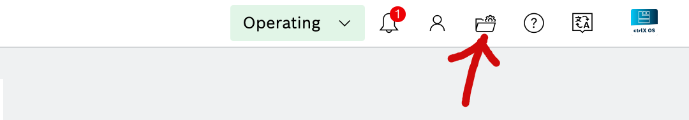
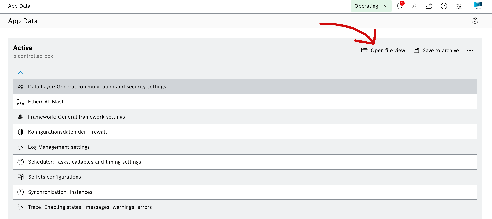
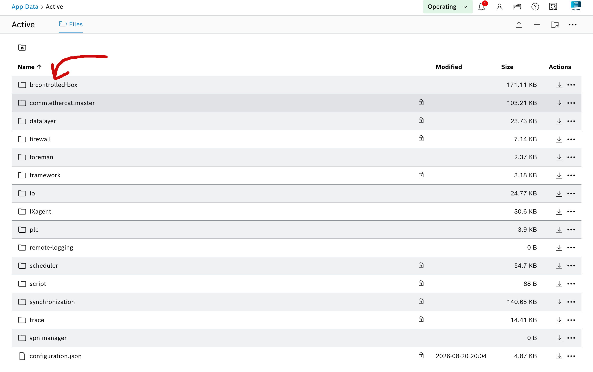
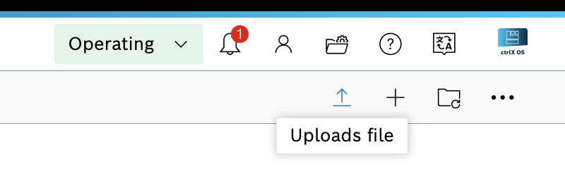
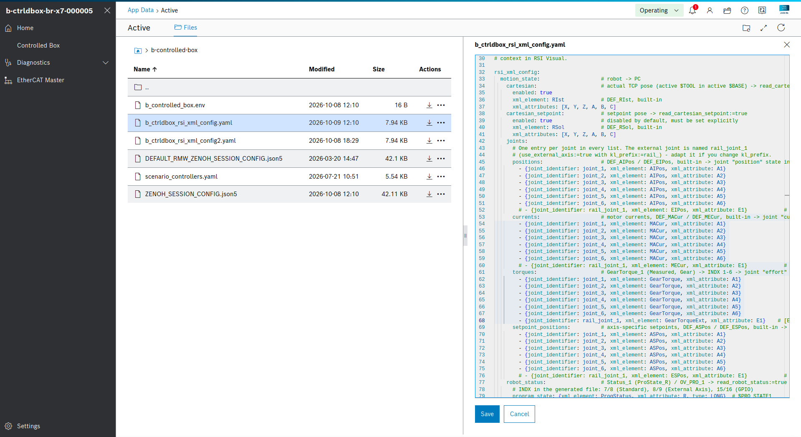

# Testing a KUKA robot with the b»Controlled Box (ctrlX CORE)

Step-by-step test of a KUKA robot with the driver running on the ctrlX CORE (`eki_rsi`): without
external axis and without GPIOs. The controller manager and the hardware run on the ctrlX; the PC
publishes the robot description, spawns the controllers and runs the robot manager.

Tested: KR 210 R3100-2, KSS 8.6, RSI 4.1.

## 1. Prerequisites

- KUKA controller set up as described in [`KUKA.md`](../../docs/supported_robots/KUKA.md) (RSI and
  EKI interfaces), with the **Standard** configuration deployed (`kss_deployment/deploy.bat`, see
  [`LAUNCH.md`](LAUNCH.md), section 2.3).
- Driver YAML uploaded to the ctrlX in
  `/var/snap/rexroth-automationcore/common/solutions/activeConfiguration/b-controlled-box/`
  (here `b_ctrldbox_rsi_xml_config2.yaml`), see section 1.1. It must describe the same layout as
  the configuration deployed on the KUKA - see [`LAUNCH.md`](LAUNCH.md), section 5.
- ctrlX in **OPERATIONAL** mode.
- KUKA pendant in **EXT** mode, no program selected. Otherwise `activate` fails with
  `KRC not in EXT. Switch to EXT to activate.` in the ctrlX log.

### 1.1 Upload the driver YAML to the ctrlX

The driver reads the RSI XML config YAML on the ctrlX, from the active configuration folder
`b-controlled-box`. The launch file selects it by file name (`rsi_xml_config:=<file name>`).
Upload it through the ctrlX OS web interface. The same steps apply to `scenario_controllers.yaml`
(controller parameters, e.g. the `gpio_controller` section).

1. Open **Manage app data** (folder icon in the top bar).

   <p align="center">
   
   </p>

2. Under **Active** (b-controlled box), click **Open file view**.

   <p align="center">
   
   </p>

3. Open the **b-controlled-box** folder.

   <p align="center">
   
   </p>

4. Click **Uploads file** (arrow icon at the top right) and select the YAML file from your PC,
   e.g. `workspaces/kuka/rsi_xml_config/b_ctrldbox_rsi_xml_config.yaml`.

   <p align="center">
   
   </p>

5. The file is now listed in `b-controlled-box`. Click it to check or edit the content in the
   browser, then **Save**.

   <p align="center">
   
   </p>

Use the uploaded file name in the launch command, e.g.
`rsi_xml_config:=b_ctrldbox_rsi_xml_config.yaml`. The driver reads the file when the controller
manager loads the hardware: after changing it, restart the ctrlX app and relaunch so the new content
is used.

## 2. Launch

Adjust `robot_family`, `robot_model`, `controller_ip` (KLI IP of the KUKA controller) and
`rsi_xml_config` (file name on the ctrlX) to your setup:

```bash
ros2 launch kuka_rsi_driver scenario_eki_rsi.launch.xml \
  robot_family:=quantec robot_model:=kr210_r3100_2 controller_ip:=172.31.1.178 \
  rsi_xml_config:=b_ctrldbox_rsi_xml_config2.yaml \
  read_robot_status:=true read_cartesian_pose:=true read_cartesian_setpoint:=true \
  is_async:=true
```

This publishes the robot description, spawns the controllers (inactive) on the ctrlX controller
manager `/b_controlled_box_cm` and starts the `robot_manager` lifecycle node.

| Argument | Meaning |
| :------- | :------ |
| `robot_family`, `robot_model` | robot description to load, e.g. `quantec` / `kr210_r3100_2` |
| `controller_ip` | KLI IP of the KUKA controller (EKI server, TCP port `54600`) |
| `rsi_xml_config` | file name of the driver YAML on the ctrlX. Empty = driver defaults (joint positions and Cartesian pose only) |
| `read_robot_status` | adds the `robot_status` sensor (program state, speed scaling) |
| `read_cartesian_pose` | adds the actual TCP pose and spawns `cartesian_pose_broadcaster` |
| `read_cartesian_setpoint` | adds the setpoint TCP pose and spawns `cartesian_setpoint_broadcaster` |
| `is_async` | runs the hardware asynchronously, scheduled as `slave` on the ctrlX |

## 3. Configure and activate

> [!IMPORTANT]
> ⚠️ Wait **10 seconds** after starting the launch file, until the controllers are spawned, before
> running `configure`. Then run `activate`:

```bash
ros2 lifecycle set /robot_manager configure
ros2 lifecycle set /robot_manager activate
```

Each command prints `Transitioning successful`. On `activate`, the EKI server selects and starts
the RSI program on the KUKA automatically.

## 4. Check

```bash
ros2 topic echo /joint_states --once
ros2 topic echo /dynamic_joint_states --once
ros2 topic echo /cartesian_pose_broadcaster/pose --once
ros2 topic echo /cartesian_setpoint_broadcaster/pose --once
```

Joint positions and torques must be real values (not `NaN`). The full list of what to check is in
[`LAUNCH.md`](LAUNCH.md), section 2.5 ("What to check").

## 5. First motion

Send a small, slow move to one joint, as described in [`LAUNCH.md`](LAUNCH.md), section 2.6.

## 6. Deactivate and shut down

```bash
ros2 lifecycle set /robot_manager deactivate
ros2 lifecycle set /robot_manager shutdown
```

Stop the launch file with `Ctrl-C` afterwards.

## 7. External axis example

Same steps with an external axis (KUKA linear unit). Differences to the steps above:

- KUKA: **External Axis** configuration deployed (`deploy.bat`, configuration `2`), and the
  external axis E1 configured on the KUKA controller. Otherwise its values stay `0`.
- Driver YAML on the ctrlX: the lines tagged `[EXT_AXIS]` uncommented
  ([`LAUNCH.md`](LAUNCH.md), sections 3 and 5).

Launch:

```bash
ros2 launch kuka_rsi_driver scenario_eki_rsi.launch.xml \
  robot_family:=quantec robot_model:=kr210_r3100_2 controller_ip:=172.31.1.178 \
  rsi_xml_config:=b_ctrldbox_rsi_xml_config2.yaml \
  use_external_axis:=true kl_model:=kl100_2 kl_prefix:=rail_ \
  read_robot_status:=true read_cartesian_pose:=true read_cartesian_setpoint:=true \
  is_async:=true
```

| Argument | Meaning |
| :------- | :------ |
| `use_external_axis` | composes the robot with the linear unit and adds the external joint to the `joint_trajectory_controller`. The hardware component is named `<robot_model>_with_<kl_model>`, here `kr210_r3100_2_with_kl100_2` |
| `kl_model` | linear unit model, e.g. `kl100_2` |
| `kl_prefix` | prefix of the external joint, here `rail_` → `rail_joint_1`. Must match `joint_identifier` in the `[EXT_AXIS]` lines of the YAML |

Then configure, activate, check and shut down as in sections 3-6 (wait 10 seconds before
`configure`). `/joint_states` contains `rail_joint_1` in addition to `joint_1`..`joint_6`
(position in metres). A trajectory sent to `/joint_trajectory_controller/follow_joint_trajectory`
must list all seven joints.

## 8. GPIO example

To test digital inputs and outputs (e.g. `$IN[51]` / `$OUT[51]` with the `gpio_51` configuration)
and to add new GPIOs, follow [`ADD_GPIO.md`](ADD_GPIO.md). Launch as in section 2 with
`rsi_xml_config:=b_ctrldbox_rsi_xml_config_gpio_51.yaml use_gpio:=true`.
